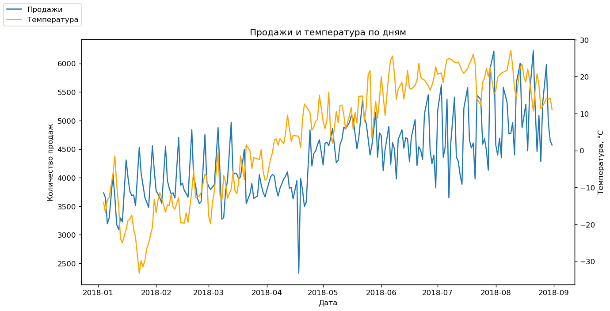
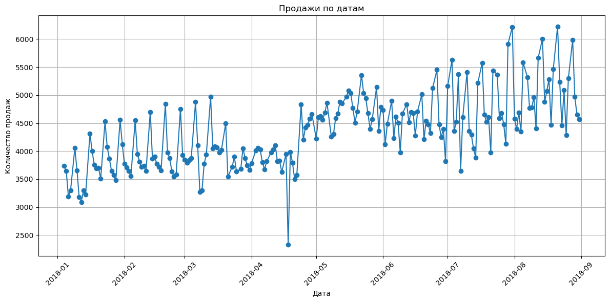

# Retail Sales & Weather Analysis (Python)

Exploratory analysis of daily retail sales across several warehouses (January–August 2018) and their relationship with air temperature in Astana.

**Tools:** Python, pandas, NumPy, matplotlib, seaborn, Jupyter Notebook

## Task

- Clean and prepare raw sales data (date parsing, type checks)
- Analyze the daily sales trend and describe seasonality
- Detect outliers in order quantities
- Find the top-selling product for a specific segment
- Enrich sales data with external weather data and measure the relationship between the two

## Data

- **Sales** (`data/data.csv`): 300K+ rows: date, warehouse, customer, product, quantity
- **Weather** (`data/weather.csv`): raw export of observations every 3 hours for Astana (station 35188) from [rp5.ru](https://rp5.ru), processed in the notebook into a daily average temperature

## What I did

1. **Data preparation.** Loaded the data, converted dates to `datetime`, aggregated sales by day.
2. **Trend analysis.** Plotted daily sales and described the dynamics.
3. **Outlier detection.** Used the IQR method (1.5 × IQR) to find anomalous order quantities.
4. **Segment analysis.** Filtered Wednesdays in June–August for warehouse 3 and ranked products by total quantity.
5. **Data enrichment.** Parsed the raw rp5 export directly in code, calculated the daily mean temperature, merged it with sales by date, plotted both series on a dual-axis chart and calculated the correlation.

## Key findings

- Daily sales grew from ~3,500–4,000 units in January–April to ~5,000–6,000 units in July–August, with clear weekly fluctuations.
- A sharp one-day drop (~2,300 units) appears in the second half of April.
- The largest outlier is a single order of 200 units (product_0, customer address_208, 28 June 2018).
- The top product on summer Wednesdays at warehouse 3 is **product_1** with 2,267 units.
- Sales and daily temperature show a **moderate positive correlation (r = 0.6)**. Both series rise from winter to summer, so part of this relationship likely reflects a shared seasonal trend rather than a direct effect of temperature on sales.

## How to run

1. Clone the repository.
2. Install the dependencies: `pip install pandas numpy matplotlib seaborn jupyter`
3. Open `Python_FP.ipynb` and run all cells. Update the file paths in the data-loading cells to point to the `data/` folder on your machine.

## Files

- `Python_FP.ipynb`: the full analysis notebook
- `data/`: sales data and the raw weather export
- `images/`: charts from the notebook
