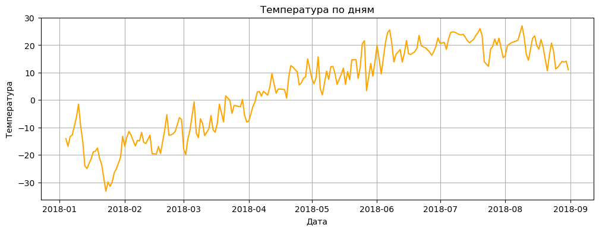

# Retail Sales & Weather Analysis (Python)

Exploratory analysis of daily retail sales across several warehouses (January–August 2018) and their relationship with air temperature in Astana.

**Tools:** Python, pandas, NumPy, matplotlib, seaborn, Jupyter Notebook

## Task

- Clean and prepare raw sales data (date parsing, type checks)
- Analyze the daily sales trend and describe seasonality
- Detect outliers in order quantities
- Find the top-selling product for a specific segment
- Enrich sales data with external weather data and compare the two series

## Data

- **Sales:** ~200K+ rows: date, warehouse, customer, product, quantity
- **Weather:** hourly temperature observations for Astana from [rp5.ru](https://rp5.ru), aggregated to a daily average

## What I did

1. **Data preparation.** Loaded the data (cp1251 encoding), converted dates to `datetime`, aggregated sales by day.
2. **Trend analysis.** Plotted daily sales and described the dynamics.
3. **Outlier detection.** Used the IQR method (1.5 × IQR) to find anomalous order quantities.
4. **Segment analysis.** Filtered Wednesdays in June–August for warehouse 3 and ranked products by total quantity.
5. **Data enrichment.** Cleaned the weather export, calculated the daily mean temperature, merged it with sales by date and visualized both series.

## Key findings

- Daily sales grew from ~3,500–4,000 units in January–April to ~5,000–6,000 units in July–August, with clear weekly fluctuations.
- A sharp one-day drop (~2,300 units) appears in the second half of April.
- The largest outlier is a single order of 200 units (product_0, customer address_208, 28 June 2018).
- The top product on summer Wednesdays at warehouse 3 is **product_1** with 2,267 units.
- Sales rise together with temperature from winter to summer, suggesting a seasonal component.

## Files

- `Python_FP.ipynb`: the full analysis notebook
- `images/`: charts from the notebook
